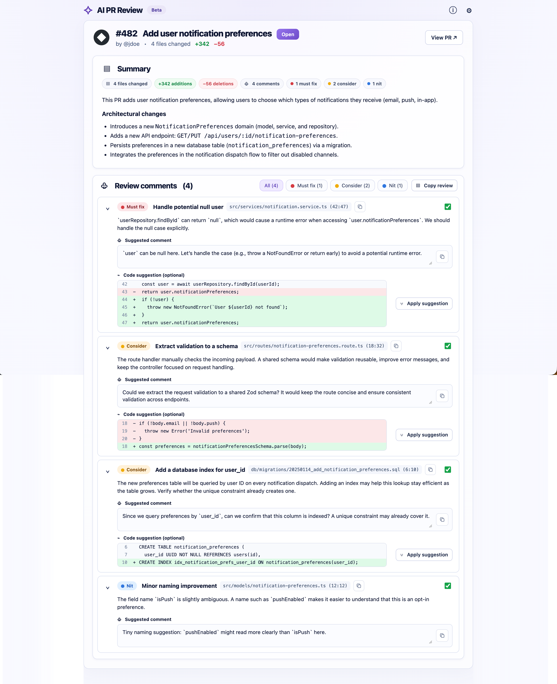

# generate-pr-review-report

[](https://www.npmjs.com/package/generate-pr-review-report)
[](LICENSE)

CLI tool for Code Review agents to render their feedbacks in a clean HTML template.

The CLI turns a structured JSON produced by an AI code-review agent into a **single, self-contained HTML file** (no external assets, no network calls). Zero dependencies — Node ≥ 18.
Easy review for the human that reads the report.



## Install

Run it without installing (always uses the latest version):

```bash
npx generate-pr-review-report -i review.json -o ./review-report-pr-482.html
```

Or install the command globally:

```bash
npm install -g generate-pr-review-report
```

Or install straight from GitHub (no npm registry needed):

```bash
npm install -g github:MaximeBF2000/generate-pr-review-report
```

## Usage

```bash
generate-pr-review-report -i '{...}' -o ./review-report-pr-482.html
generate-pr-review-report --input review.json --output ./review-report-pr-482.html
cat review.json | generate-pr-review-report -i -
```

| Flag                           | Description                                                                                                                |
| ------------------------------ | -------------------------------------------------------------------------------------------------------------------------- |
| `-i, --input`                  | Inline JSON string, path to a `.json` file, or `-` for stdin. **Required.**                                                |
| `-o, --output`                 | Output path. Defaults to `./review-report-pr-<key>.html` (or `./review-report-<branch>.html`). Parent folders are created. |
| `-h, --help` / `-v, --version` |                                                                                                                            |

On success the absolute output path is printed to **stdout** (easy for an agent to capture). On invalid input it exits `1` and lists _every_ problem on stderr, e.g. `feedbacks[2].severity: expected one of "must_fix", "should_consider", "nit"` — so the agent can fix everything in one retry.

## Using it from an AI agent skill

Add a step like this to your review skill, after the agent has built its review:

> Write the review as JSON (schema below) to a temporary file, then run
> `npx -y generate-pr-review-report -i <tmp>.json -o ./review-report-pr-<number>.html`.
> If the command exits with code 1, fix every error it lists and run it again.
> Return the path it prints.

Prefer a temp file (or stdin) over inline `-i '{...}'`. Markdown in summaries often contains `'` and `` ` `` characters that break shell quoting.

## JSON schema

```jsonc
{
  "key": 482, // PR number (or any string id) — optional
  "branch": "feature/my-feature", // optional
  "url": "https://github.com/u/r/pull/482", // optional — enables the "View PR" button
  "title": "Add user notification preferences", // required — the PR title
  "summary": "Markdown…", // required — overview, architecture, context
  "author": "jdoe", // optional (leading @ is stripped)
  "numberOfFilesChanged": 4, // optional
  "numberOfLinesAdded": 342, // optional
  "numberOfLinesDeleted": 56, // optional
  "feedbacks": [
    // required — use [] for a clean PR ("Ready to merge" view)
    {
      "file": "src/services/notification.service.ts", // required
      "severity": "must_fix", // required: must_fix | should_consider | nit
      "lineStart": 42, // optional
      "lineEnd": 47, // optional (defaults to lineStart)
      "title": "Handle potential null user", // optional — short headline; derived from `comment` if omitted
      "text": "Markdown explanation for you (can be verbose)", // required
      "comment": "Concise comment to post on the PR", // required — editable + copyable in the report
      "suggestion": " context\n-removed\n+added" // optional — unified-diff lines, numbered from lineStart
    }
  ]
}
```

`title` and `suggestion` are optional additions to the original brief: they power the finding headline and the "Code suggestion" diff block.

Severity aliases like `must-fix`, `Must fix`, `consider`, `nitpick` are accepted and normalized. Findings are shown ordered by severity.

## The generated report

- Header with PR number, title, author, size, branch and a link to the PR
- Summary rendered from Markdown, with stats pills (files, +/−, comments per severity)
- Review comments filterable by severity, collapsible, each with a copy-path button, an **editable** suggested comment with a copy button, and an optional diff
- Checkboxes choose which comments go into **Copy review** (copies the whole review as Markdown, including your edits)
- Empty state "No feedback — PR looks good to go" when `feedbacks` is `[]`
- All agent-provided text is HTML-escaped; Markdown links only allow http(s)/mailto/relative URLs

## Project layout

```
bin/generate-pr-review-report.js   CLI (argument parsing, I/O)
src/validate.js                    schema validation + normalization
src/markdown.js                    tiny safe Markdown renderer
src/render.js                      builds the HTML fragments, fills the template
templates/report.html              page shell: CSS + interaction script
examples/                          sample inputs (with findings / clean PR)
```

## Development

```bash
git clone https://github.com/MaximeBF2000/generate-pr-review-report.git
cd generate-pr-review-report
npm link          # use your local checkout as the global command
npm run example   # builds out/review-report-pr-482.html and out/review-report-pr-728.html
npm test
```

### Releasing a new version

```bash
npm version patch   # or minor / major — bumps package.json and creates a git tag
git push --follow-tags
npm publish         # runs the tests first (prepublishOnly)
```

## License

MIT
